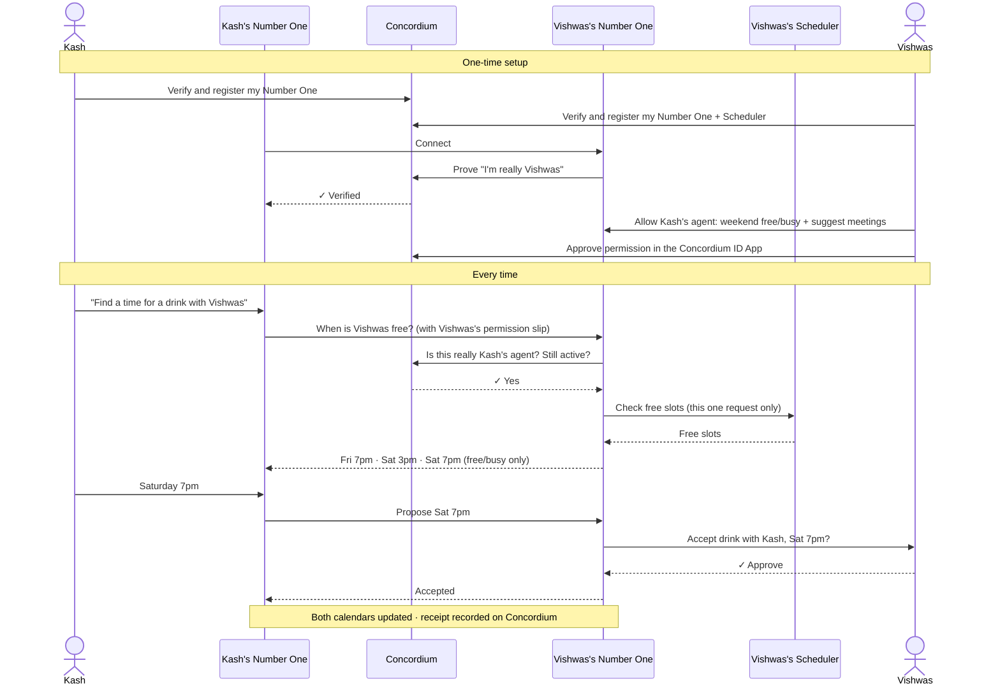
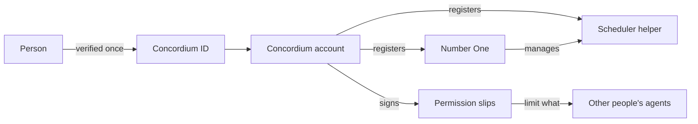

# Number One: Trusted AI Agents on Concordium
**Business overview · Phase 1 proof of concept · Nov 2026**

---

## Vision
Everyone gets a personal AI assistant, their **Number One**, with a small team of helper agents.

Number Ones work things out **with each other** for their owners: finding a time to meet, planning a dinner, sorting the details.

**Concordium makes it trustworthy.** You always know whose agent you're talking to, and your agent only does what you've allowed.

## Problem Statement
Arranging even simple things takes a lot of back-and-forth: *"Can't do Friday… what about Sunday… any allergies?"*

AI agents could do this for us. But the moment one person's agent talks to another's, there are four questions nobody can answer today:

1. **Is this really my friend's agent, or an impostor?**
2. **Is there a real, verified person behind it?**
3. **What is it allowed to ask, and what may mine share?**
4. **Did the person actually agree to this?**

Without answers, nobody will let an agent act on their behalf.

## Business Value
| For | Value |
|---|---|
| **Concordium** | A live showcase of Concordium as the **trust layer for AI agents**: identity, agent registry, consent and audit working together in one simple product |
| **Users** | Agents do the legwork, and people stay in control: they choose who their agent talks to, about what, and for how long |
| **Partners & businesses** | One trust pattern that carries over to bigger use cases: dinner planning and allergies, shopping and payments, sharing certificates. Each one builds on the same foundation. |
| **Risk** | Every agent is tied to a verified person, every permission is limited and can be withdrawn, and every important action leaves a tamper-proof record |

## Solution

### User journey: "Let's grab a drink"
Kash wants to meet Vishwas next week, and neither of them wants five rounds of WhatsApp messages.

| Step | What happens | Who's involved |
|---|---|---|
| **1. Get set up** (once) | Each person signs in with Concordium. Their Number One and its Scheduler helper get registered under their verified identity. | each person |
| **2. Connect** (once per friend) | Kash and Vishwas connect their Number Ones. Each one proves *"I'm really Vishwas"* or *"I'm really Kash"* with Concordium ID. | both |
| **3. Give permission** (once) | Vishwas allows Kash's agent to **see when he's free on weekends** and **suggest meetings**, until February. He approves it in the Concordium ID App. | Vishwas |
| **4. Ask** | Kash: *"Find a time for a drink with Vishwas next week."* | Kash |
| **5. Agents agree** | Kash's agent asks Vishwas's agent. Vishwas's agent checks who's asking and what's allowed, asks its Scheduler for free slots, and shares **only free/busy times**: no event details. | the agents |
| **6. Confirm** | Kash picks Saturday 7pm. Vishwas gets one request: *"Accept drink with Kash, Sat 7pm?"* He approves, and both calendars update. | Kash, then Vishwas |

**If an impostor tries:** an agent that isn't registered, has been switched off, or isn't Vishwas's real agent is turned away automatically. Kash is told why.

### How it works
Six building blocks, all built on Concordium:

| # | Building block | In one line |
|---|---|---|
| 1 | **Verified owner** | Every user is identity-verified once through Concordium ID |
| 2 | **Agent badge** | Every agent (the Number One and each helper) is registered on the **Concordium Agent Registry** under its owner, like a car registered to a driver |
| 3 | **Prove who you are** | When two people connect, each proves their identity to the other with Concordium ID, revealing **only their name** and nothing else |
| 4 | **Permission slips** | The owner signs exactly what another agent may do: which actions, which days, until when. Permissions can only shrink as they're passed on, and they can be withdrawn at any time. |
| 5 | **Human in the loop** | Anything that commits the owner, like accepting a meeting or giving a new permission, waits for the owner's approval |
| 6 | **Tamper-proof record** | Verifications and agent actions leave receipts on Concordium, so anyone can check later what was agreed |

**What stays private:** calendars, preferences and personal details never go on the blockchain. Only badges, receipts and fingerprints of agreements do.

**Proof of concept scope:** two users and one task (calendar scheduling), end to end on Concordium testnet. It includes the "impostor rejected" demo.
