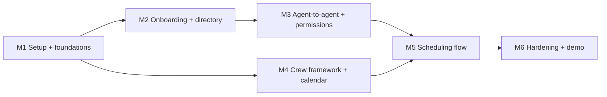

# Number One: POC Roadmap
**Implementation milestones for the Phase 1 POC** · v0.2 · Nov 2026

> Scope: [poc-scope.md](poc-scope.md) · Architecture: [technical-solution.md](technical-solution.md) · Implementation details: [spec/](spec/README.md).

---

## 1. Overview
Six milestones over **4 weeks**. M1 sets up the project and de-risks the Concordium dependencies. Each later milestone ends with a demoable result tied to the success criteria (S1–S8) and negative tests (NT1–NT11) in poc-scope.md.

| # | Milestone | Week | Exit criteria |
|---|---|---|---|
| M1 | Project setup + foundations | 1 | Repo + compose running locally (relay + 2 nodes); `trust-lib` basics; spike results for the wallet calls |
| M2 | Onboarding + directory | 1–2 | S1, S2, NT11 |
| M3 | Agent-to-agent + permissions | 2 | S3 (first contact + grant), NT1, NT3, NT7 |
| M4 | Crew framework + calendar crew | 3 | Calendar crew installed via setup; slip ①; My calendar + Add busy time; NT8 |
| M5 | Scheduling flow | 3–4 | S4, S5, S6, NT4, NT5, NT6, NT9 |
| M6 | Hardening + demo | 4 | S7, S8, NT2, NT10; deliverables 1–4 |

M4 can start in parallel with M3 once M1 is done: the crew framework and the Calendar Gateway don't need messaging.

## 2. Milestones

### M1. Project setup + foundations (week 1)
**Goal:** one repo where every component builds and runs locally, a shared trust library, and answers to the Concordium unknowns before building on them.

**Project setup**
| Task | Output |
|---|---|
| Monorepo (pnpm workspaces): `apps/ui`, `apps/n1-agent`, `apps/calendar-gateway`, `apps/relay-service`, `packages/trust-lib`, `tools/evil-peer`, `deploy/` | Each app builds; shared lint, format, test (vitest) config |
| `deploy/node/docker-compose.yml` (ui, n1-agent, calendar-gateway, verifier) and `deploy/relay/docker-compose.yml` (relay-service, verifier, SQLite volume) with configurable ports and folders | [spec/node/README.md](spec/node/README.md), [spec/relay/README.md](spec/relay/README.md) |
| **Local setup:** relay + 2 nodes on one laptop (`deploy/local/`, Makefile) | [spec/local-dev.md](spec/local-dev.md) |
| Hello-world wiring: `ui` → `n1-agent` local API + SSE; `n1-agent` → relay health; `n1-agent` → gateway health | All containers talk |

**Foundations**
| Task | Spec |
|---|---|
| **`trust-lib` basics:** JCS, SHA-256, Ed25519 keys + multibase, encrypted keystore, `eddsa-jcs-2022` sign/verify, reason codes | [trust-lib.md](spec/shared/trust-lib.md), [identifiers-and-encoding.md](spec/shared/identifiers-and-encoding.md) |
| **Chain client:** gRPC to testnet; CIS-8004 `agentOf` / `getMetadata`; `getAccountInfo`; account by `credRegId`; read `RegisterData` transactions | [trust-lib.md](spec/shared/trust-lib.md) §2 |

**Spikes (days 1–3)**
| Spike | Output |
|---|---|
| **Attestation proof:** the Browser Wallet answers a Verify & Access request with `source: accountCredential`, revealing `firstName`, `lastName` and proving 18+; `credRegId` resolves to X | Exact wallet call + a sample VP/VPR |
| **Consent proof:** same, with **empty statements** | Works, or use `RevealAttribute firstName` |
| Credential Verification Service runs locally with a service account; VRA/VAA anchored | Working verifier container + response field names |
| CIS-8004 on testnet: `register`, `setAgentURI`, `revoke`, `agentOf`; read the token ID from the `Registered` event | Contract address, metadata limits |
| Testnet accounts: 3 owners (ID-backed, different test identities), 3 node service accounts, 1 attester account, all funded | Accounts ready |

**Exit:** `make relay && make node NAME=kash && make node NAME=vishwas` runs all containers locally; `trust-lib` has unit tests; spike results recorded in `spec/`. **Gate:** if the consent VP doesn't work, use the fallback (X signs the approval with the Browser Wallet's `signMessage`).

### M2. Onboarding + directory (weeks 1–2)
**Goal:** a user goes from a fresh install to an attested N1 that others can see and verify.

| Task | Component | Spec |
|---|---|---|
| Setup wizard: Browser Wallet connect + signed link challenge (binds X to the node) | `ui`, `n1-agent` | [ui.md](spec/node/ui.md) §3 |
| Crew choice step (Calendar pre-selected; just the choice here, the crew is built in M4) | `ui`, `n1-agent` | [crew-modules.md](spec/shared/crew-modules.md) §2 |
| Generate invocation, delegation and encryption keys; build the Agent Card (keys, `crews`, per-crew policy); upload it to the relay card store | `n1-agent`, `relay-service` | [agent-card.md](spec/shared/agent-card.md) |
| Register the N1 on CIS-8004 (Browser Wallet `sendTransaction`); read the token ID | `ui`, `n1-agent` | [agent-card.md](spec/shared/agent-card.md) §4 |
| **Attester:** create the VPR, verify the VP, check `credRegId` → X and X owns the agent, anchor the VAA, sign the attestation, publish `attester.json` | `relay-service`, relay `verifier` | [relay-service.md](spec/relay/relay-service.md) §3.3, [attestation.md](spec/shared/attestation.md) |
| Relay **directory index** (attested agents + cards) + 5-minute refresh against the chain | `relay-service` | [relay-service.md](spec/relay/relay-service.md) §3.4, [database.md](spec/relay/database.md) |
| **Each node verifies the directory:** `verifyAgent` + `verifyAttestation` (pinned attester key, VAA on chain) per entry; cache | `n1-agent` | [n1-agent.md](spec/node/n1-agent.md) §5.1 |
| Directory screen: name, 18+ badge, crew icons; rejected entries greyed out with their reason | `ui` | [ui.md](spec/node/ui.md) §2 |

**Exit:** **S1** (Vishwas set up and attested, VAA shown), **S2** (Kash's directory shows Vishwas ✓ 18+), **NT11** (forged or expired attestation dropped).

### M3. Agent-to-agent + permissions (week 2)
**Goal:** verified N1s can talk, and an owner can let a peer in.

| Task | Component | Spec |
|---|---|---|
| Relay WebSocket: agent-key auth, store-and-forward, ack, presence | `relay-service` | [relay-service.md](spec/relay/relay-service.md) §3.1 |
| Relay client in `n1-agent` (reconnect, de-duplication) | `n1-agent` | [n1-agent.md](spec/node/n1-agent.md) §2 |
| Envelopes: signing, the 9 receive checks, replay cache; handshake and sessions | `trust-lib`, `n1-agent` | [messages.md](spec/shared/messages.md) |
| **First contact:** `contact.request` → inbox → "pending permission" | `n1-agent`, `ui` | [n1-agent.md](spec/node/n1-agent.md) §5.2 |
| **ZCAP core:** slip format, root resolution (X → N1 → card → delegation key), `delegationPolicy` check, `verifyChain` / `verifyInvocation`, core caveats | `trust-lib` | [capabilities.md](spec/shared/capabilities.md) |
| **Reactive grant:** **Allow** → scope dialog → slip ② signed by the delegation key → `capability.grant` → the requester verifies and stores it, then retries | `n1-agent`, `ui` | [capabilities.md](spec/shared/capabilities.md) §8 |
| Slip revocation + `capability.revoke`; Permissions screen | `n1-agent`, `ui` | [flows.md](spec/flows.md) F4 |
| Audit log (hash-chained, signed) for every trust decision; trust-log events | `n1-agent` | [n1-agent.md](spec/node/n1-agent.md) §5.5 |
| Conversation view (agent-to-agent envelopes) | `ui` | [ui.md](spec/node/ui.md) §2 |

**Exit:** **S3**: Kash → Pete first contact, nothing shared, Pete allows, Kash's N1 holds a valid slip ②. Negative tests **NT1** (unregistered), **NT3** (impostor), **NT7** (replay).

### M4. Crew framework + calendar crew (week 3, can start in week 2)
**Goal:** the generic crew plug-in model, with Calendar as the first crew.

| Task | Component | Spec |
|---|---|---|
| **Crew framework:** module interface, loader, action, caveat and message registries, `GET /api/crews`, crew setup, My crew page | `n1-agent`, `trust-lib`, `ui` | [crew-modules.md](spec/shared/crew-modules.md) |
| **Gateway contract** (`/v1/invoke`, `/v1/log`, `/health`) + `/internal/*` on `n1-agent` | `calendar-gateway`, `n1-agent` | [crew-modules.md](spec/shared/crew-modules.md) §4a |
| **Calendar Gateway:** mock adapter (SQLite + seed), invocation checks, `freebusy.read`, `event.list`, `event.create`, `event.insert` (confirmation checked in M5) | `calendar-gateway` | [calendar-gateway.md](spec/node/calendar-gateway.md) |
| **Calendar module:** actions, caveats (`SharingTier`, `PermittedDays`, `SlotGranularity`), default policy and grant, `setup()` issues slip ① | `n1-agent` | [crews/calendar.md](spec/crews/calendar.md) §1–4 |
| **My calendar** view + **Add busy time** | `ui`, `n1-agent` | [crews/calendar.md](spec/crews/calendar.md) §9 |
| Fake crew + stub gateway for tests (proves the core has no calendar code) | tests | [testing.md](spec/testing.md) §1 |

**Exit:** a new user picks Calendar at setup, it's set up with slip ①, My calendar shows the seed plus added busy time; **NT8** (gateway rejects without a valid slip ①).

### M5. Scheduling flow (weeks 3–4)
**Goal:** the happy path. Kash asks, the agents negotiate while Vishwas is away, and Vishwas approves when he's back.

| Task | Component | Spec |
|---|---|---|
| **LLM intent:** OpenAI JSON-schema output (or scripted parser) → crew intent → task | `n1-agent` | [n1-agent.md](spec/node/n1-agent.md) §5.4 |
| **Tasks:** core task state machine; module `start()`; auto-retry after a grant | `n1-agent` | [n1-agent.md](spec/node/n1-agent.md) §5.3 |
| **Availability:** `calendar.availability.request` with an invocation of slip ② → approver checks + gateway `freebusy.read` → free-slot options (tier, days, granularity) | `n1-agent` (calendar module) | [crews/calendar.md](spec/crews/calendar.md) §6 |
| Chat options rendered with `slot-list`; owner picks → `commitment.propose` | `ui`, `n1-agent` | [ui.md](spec/node/ui.md) §2 |
| **Commitment protocol:** validate, conflicts, recheck, tentative hold, `commitment.tentative`, 24 h hold expiry, decline | `n1-agent` | [consent.md](spec/shared/consent.md) §3 |
| **Consent:** Pending approvals → Approve → node verifier creates the VPR → **Browser Wallet** answers → verify + `credRegId` → own X | `n1-agent`, node `verifier`, `ui` | [consent.md](spec/shared/consent.md) §4–5 |
| **Execute on both sides:** approver gateway insert with the consent record; `commitment.confirmed`; requester gateway insert with the approver's confirmation | `n1-agent`, `calendar-gateway` | [consent.md](spec/shared/consent.md) §6 |

**Exit:** **S4**, **S5** (Vishwas away → tentative), **S6** (Vishwas approves at his desk → event in both My calendar views). Negative tests **NT4** (no slip), **NT5** (outside slip), **NT6** (widened or unknown caveat), **NT9** (insert without consent).

### M6. Hardening + demo (week 4)
**Goal:** everything can be withdrawn and checked, every attack is rejected visibly, and the demo is repeatable.

| Task | Component | Spec |
|---|---|---|
| Revoke an N1 (CIS-8004) from Settings; peers reject it | `ui`, `n1-agent` | [flows.md](spec/flows.md) F5 |
| Delegation key rotation (`setAgentURI`); old slips stop verifying | `ui`, `n1-agent` | [agent-card.md](spec/shared/agent-card.md) §6 |
| Audit anchoring ("Anchor now") + transaction shown | `n1-agent`, `ui` | [flows.md](spec/flows.md) F6 |
| Trust log screen polished for the demo (filters, reasons) | `ui` | [ui.md](spec/node/ui.md) §2 |
| `tools/evil-peer`: scripted NT1–NT11 with a pass/fail report | tools | [testing.md](spec/testing.md) §2 |
| Docker images; 3-user rehearsal on testnet following the demo script | all | poc-scope §7 |
| Demo video | — | Deliverable 2 |
| Bring [`spec/`](spec/README.md) in line with what was built | — | Deliverable 3 |
| Findings note for Concordium (G1–G10, recommendations, e.g. a consent screen in the Browser Wallet) | — | Deliverable 4 |
| *(Stretch)* Google Calendar adapter | `calendar-gateway` | |
| *(Stretch)* Second crew (`notes`) added and removed live | `n1-agent`, new gateway | [crew-modules.md](spec/shared/crew-modules.md) §7 |

**Exit:** **S7** (all NT1–NT11 rejected with reasons in the trust log), **S8** (anchors found on chain), **NT2** (revoked agent), **NT10** (revoked slip); all four deliverables in poc-scope.md §12.

## 3. Decisions (before M1)
| # | Decision | Recommendation |
|---|---|---|
| R1 | Language/runtime | **TypeScript (Node.js 22)** throughout: the Concordium web SDK and Browser Wallet APIs are TypeScript-first |
| R2 | Repo | One monorepo with pnpm workspaces |
| R3 | Backend framework | Fastify (or NestJS with the Fastify adapter if the team prefers it); trust checks stay in `trust-lib` either way |
| R4 | UI framework | React + Vite (localhost) |
| R5 | Keys | Ed25519 (matches Concordium account keys and `eddsa-jcs-2022`) |
| R6 | LLM | **OpenAI** via the owner's own API key (JSON-schema output for intents); scripted parser as a fallback for a deterministic demo |
| R7 | Relay hosting | One small VM or container service (WSS + verifier + attester key); local relay for development |

## 4. Risks to the schedule
| Risk | Milestone | Mitigation |
|---|---|---|
| The Browser Wallet calls behave differently than expected | M2, M5 | Spikes in M1; fallback for consent is `signMessage` by X |
| Verifier / VRA-VAA anchoring is slow on testnet | M2, M5 | Async UI states; pre-fund accounts |
| Root resolution via CIS-8004 + Agent Card adds latency to every slip check | M3, M5 | Cache resolved cards per agent; invalidate on `metadata_hash` change |
| Crew framework takes longer than expected | M4 | Start it in week 2 in parallel with M3; keep the interface to what calendar needs |
| LLM non-determinism in the demo | M5, M6 | Scripted intent parser for the recorded demo |
| Integration surprises in the last week | M6 | Local multi-node setup from M1, so every milestone is tested between two nodes |
