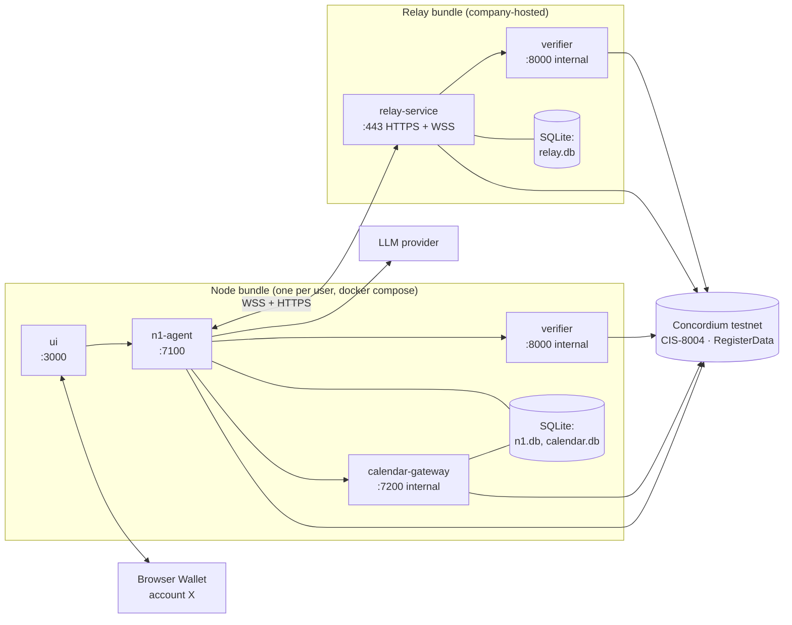

# Number One: Implementation Spec
**Phase 1 POC** · v0.1 · Nov 2026

> Business context: [business-overview.md](../business-overview.md) · Architecture: [technical-solution.md](../technical-solution.md) · Scope: [poc-scope.md](../poc-scope.md) · Milestones: [roadmap.md](../roadmap.md)

This folder is what developers build from. It covers **how** each component works; the documents above cover **why**. Where this spec and an architecture document disagree, the architecture document wins, and this spec must be fixed.

---

## 1. System overview
Two deployable bundles: one **node bundle** per user, and one **relay bundle** run by the company.

| Bundle | Service | Spec | One-line role |
|---|---|---|---|
| Node | `n1-agent` | [node/n1-agent.md](node/n1-agent.md) | The N1 agent: trust engine, slips, negotiation, consent, audit, local API |
| Node | `ui` | [node/ui.md](node/ui.md) | Local web app: setup wizard, directory, inbox, chat, consents, calendar, trust log |
| Node | `verifier` | [node/verifier.md](node/verifier.md) | Concordium Credential Verification Service for the owner's **consent** (a Verify & Access proof from their Browser Wallet) |
| Node | `calendar-gateway` | [node/calendar-gateway.md](node/calendar-gateway.md) | The calendar crew's gateway: the only component with calendar access; acts only on valid slip invocations |
| Relay | `relay-service` | [relay/relay-service.md](relay/relay-service.md) | Messaging, presence, directory index, Agent Card cache, attester |
| Relay | database | [relay/database.md](relay/database.md) | SQLite schema for the relay |
| Relay | `verifier` | [relay/verifier.md](relay/verifier.md) | Credential Verification Service for the **name + 18+** attestation |

Bundle setup: [node/README.md](node/README.md) · [relay/README.md](relay/README.md)

## 2. Shared specs
| Spec | Covers |
|---|---|
| [shared/identifiers-and-encoding.md](shared/identifiers-and-encoding.md) | IDs, canonical JSON, hashing, keys, time, error format |
| [shared/agent-card.md](shared/agent-card.md) | Agent Card, keys, `delegationPolicy`, CIS-8004 registration and rotation |
| [shared/attestation.md](shared/attestation.md) | Name + 18+ attestation format and how nodes verify it |
| [shared/messages.md](shared/messages.md) | Envelope, handshake, message types, replay rules |
| [shared/capabilities.md](shared/capabilities.md) | ZCAP profile: slips, invocations, root resolution, caveats, validation |
| [shared/crew-modules.md](shared/crew-modules.md) | Crew plug-ins (calendar first): module interface, gateway contract, add/remove |
| [shared/consent.md](shared/consent.md) | Generic commitment protocol, consent request, confirmation |
| [shared/trust-lib.md](shared/trust-lib.md) | The shared TypeScript package that implements all of the above |
| [shared/reason-codes.md](shared/reason-codes.md) | Every accept/reject reason shown in the trust log |

**Crews** (everything crew-specific lives here, never in the core):

| Spec | Covers |
|---|---|
| [crews/calendar.md](crews/calendar.md) | The calendar crew: actions, caveats, policy, intents, negotiation messages, commitment hooks, gateway, UI |

End-to-end sequences: [flows.md](flows.md) · Tests and acceptance: [testing.md](testing.md) · Relay + 2 nodes on one laptop: [local-dev.md](local-dev.md)

## 3. Conventions
| Topic | Rule |
|---|---|
| Language | TypeScript (Node.js 22 LTS) for every service we write; React + Vite for `ui` |
| Repo layout | `packages/trust-lib`, `apps/n1-agent`, `apps/ui`, `apps/calendar-gateway`, `apps/relay-service`, `deploy/node/`, `deploy/relay/`, `tools/evil-peer` |
| Network | Concordium **testnet** only |
| Trust decisions | Plain code in `trust-lib` / `n1-agent` / `calendar-gateway`. **Never** the LLM. |
| Fail closed | Any unknown field, type, caveat or state → reject with a reason code |
| Logging | Every trust decision emits a trust-log event (`n1-agent`) with a reason code |
| Spec file template | Purpose · Responsibilities · Interfaces · Data · Config · Errors · Security notes · Tests |

## 4. Port map
| Service | Port | Exposed to |
|---|---|---|
| `ui` | 3000 | `127.0.0.1` only (owner's browser) |
| `n1-agent` | 7100 | `127.0.0.1` only (`ui`) |
| `calendar-gateway` | 7200 | Docker network only (`n1-agent`) |
| node `verifier` | 8000 / 8001 | Docker network only (`n1-agent`) |
| `relay-service` | 443 | Internet (HTTPS + WSS) |
| relay `verifier` | 8000 / 8001 | Docker network only (`relay-service`) |

## 5. Glossary
| Term | Meaning |
|---|---|
| **X** | The owner's ID-backed Concordium account, in the Browser Wallet |
| **N1** | The owner's Number One agent, a CIS-8004 NFT owned by X (e.g. #42 Vishwas, #17 Kash) |
| **Agent Card** | Off-chain JSON with the agent's public keys and `delegationPolicy`; its hash is on chain |
| **Invocation key** | Agent key that signs envelopes, the handshake and slip invocations |
| **Delegation key** | Agent key that signs slips, within `delegationPolicy` |
| **Crew** | A pluggable skill of the N1 (module + gateway + card entry). POC: Calendar. |
| **Slip ①** | Capability: owner → own N1, per crew (e.g. own calendar) |
| **Slip ②** | Capability: owner → a peer's N1 (e.g. weekend free/busy + propose) |
| **Attestation** | The relay attester's signed statement: agent, owner X, name, 18+ |
| **Attester** | The relay's verifier + signing key that checks the onboarding proof |
| **Node service account** | Low-value Concordium account used by the node for anchors (never X) |
| **VPR / VP** | Verifiable presentation request / verifiable presentation (Verify & Access) |
| **VRA / VAA** | On-chain anchors for the request / the verification result |
| **Approver** | The owner whose resource a commitment would use (e.g. Vishwas's calendar); the only one who consents, in their Browser Wallet at their desk |
