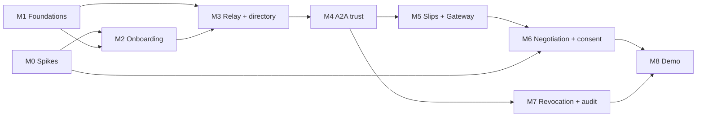

# Number One: POC Roadmap
**Implementation milestones for the Phase 1 POC** · v0.1 · Nov 2026

> Scope: [poc-scope.md](poc-scope.md) · Architecture: [technical-solution.md](technical-solution.md) · Implementation details: [spec/](spec/README.md).

---

## 1. Overview
Nine milestones over **4 weeks**. M0 de-risks the Concordium dependencies first. Each later milestone ends with a demoable result tied to the success criteria (S1–S8) and negative tests (NT1–NT11) in poc-scope.md.

| # | Milestone | Week | Exit criteria |
|---|---|---|---|
| M0 | Spikes & environment | 1 | Exact Browser Wallet calls for the attestation proof (G1) and the consent proof |
| M1 | Foundations | 1 | Node bundle + relay skeleton running; shared trust library |
| M2 | Onboarding & attestation | 1–2 | S1 |
| M3 | Relay & directory | 2 | S2, NT11 |
| M4 | Agent-to-agent trust | 2 | S3, NT1–3, NT7 |
| M5 | Capabilities & Calendar Gateway | 3 | S4, NT4–6, NT8, NT10 (slip revocation) |
| M6 | Negotiation & confirmation | 3–4 | S5, S6, NT9 |
| M7 | Revocation, audit & trust log | 4 | S7, S8, NT2 |
| M8 | End-to-end demo & handover | 4 | Deliverables 1–4 |

## 2. Milestones

### M0. Spikes & environment (week 1, days 1–3)
**Goal:** confirm the critical Concordium dependencies before building on them.

| Task | Output |
|---|---|
| **G1 spike:** Browser Wallet account-credential VP revealing `firstName`, `lastName`, and proving 18+ (age range) | Working sample VP + VPR, or a documented failure |
| Check that `credRegId` in the VP resolves to the owner account X | Confirmed lookup path |
| **Consent-proof spike:** the Browser Wallet answers a Verify & Access request with `source: accountCredential` and **empty statements**; `credRegId` resolves to X | Working consent VP; if empty statements are refused, use `RevealAttribute firstName` |
| Run the Credential Verification Service locally (Docker) with a service account | Running verifier; VRA/VAA anchored |
| CIS-8004 on testnet: register, `setMetadata`, `getMetadata`, `revoke`, `agentOf` | Contract address, metadata limits |
| Testnet accounts: 3 owners, 3 node service accounts, 1 attester account, all funded | Accounts ready |

**Exit:** **decision gate**, end of week 1:
- The team has confirmed the Browser Wallet supports Verify & Access, so this gate only fixes the exact calls and statement formats.
- If the consent VP turns out not to work: fall back to a confirmation signed by X with the Browser Wallet's `signMessage` (shows the text, still bound to X).

### M1. Foundations (week 1)
**Goal:** the skeleton every later milestone plugs into.

| Task | Component |
|---|---|
| Repo layout: `ui`, `n1-agent`, `calendar-gateway`, `relay`, shared `trust-lib` | all |
| `docker-compose.yml` for the node bundle (4 services + `.env`); separate deploy for the relay | bundle, relay |
| **`trust-lib`:** JCS canonicalisation, Ed25519 keys (invocation + delegation), envelope sign/verify, Concordium account-signature verify (wallet-link challenge only), hashing | shared |
| **Chain client:** gRPC to testnet; CIS-8004 reads (owner, status, metadata); account keys | `n1-agent`, relay |
| Agent keystore (encrypted, local) | `n1-agent` |
| Local API between `ui` and `n1-agent`; trust-log event stream | `ui`, `n1-agent` |

**Exit:** `docker compose up` starts all four services; the relay runs; `trust-lib` has unit tests.

### M2. Onboarding & attestation (weeks 1–2)
**Goal:** a user goes from a fresh install to an attested N1.

| Task | Component |
|---|---|
| Setup wizard: Browser Wallet connect, signed link challenge (binds X to the node) | `ui`, `n1-agent` |
| Generate the invocation + delegation keys; N1 registration on CIS-8004 signed by X; Agent Card (invocation, delegation and encryption keys + `crews` + per-crew `delegationPolicy`) with `metadata_hash` | `ui`, `n1-agent` |
| **Attester:** create a VPR (context: agent ID, X, nonce), verify the VP, check that `credRegId` resolves to X and X owns the agent, anchor the VAA | relay |
| Sign the attestation (agent, X, name, 18+, VAA ref, 90-day expiry); publish the attester public key | relay |

**Exit:** **S1**: Vishwas finishes setup and the trust log shows "attested: Vishwas, 18+, owner = X" with the VAA transaction.

### M3. Relay & directory (week 2)
**Goal:** nodes find each other, and trust is decided locally.

| Task | Component |
|---|---|
| WSS messaging: node authenticates with an agent-key signature (checked against CIS-8004 and the card) | relay |
| Store-and-forward queue; presence | relay |
| Directory index (attested agents, attestations, cached Agent Cards) | relay |
| **Directory client:** fetch the index; verify each entry (active, owned by X, card hash, attestation signature + expiry, VAA on chain); cache | `n1-agent` |
| Directory view (name, 18+ badge, online) | `ui` |

**Exit:** **S2**: Kash sees Vishwas ✓ 18+ and Pete ✓ 18+. **NT11**: a forged or expired attestation is dropped.

### M4. Agent-to-agent trust (week 2)
**Goal:** signed, verified conversations between N1s.

| Task | Component |
|---|---|
| Envelope format: fixed message types, schemas, nonces, timestamps; replay cache | `n1-agent` |
| `verifyAgent` (registry + card hash + attestation) and signed handshake | `n1-agent` |
| First contact: `contact.request` accepted from any verified N1 into the inbox; nothing shared; reply "pending permission" | `n1-agent`, `ui` |
| Audit log: signed, hash-chained entries for every trust decision | `n1-agent` |
| Conversation view (agent-to-agent messages) | `ui` |

**Exit:** **S3** (Kash → Pete, nothing shared). Negative tests **NT1** (unregistered), **NT3** (impostor), **NT7** (replay). **NT2** (revoked agent) is tested here against a revoked test agent, and again with the revoke UI in M7.

### M5. Capabilities & Calendar Gateway (week 3)
**Goal:** authority comes only from slips rooted at X, and only the Gateway touches the calendar.

| Task | Component |
|---|---|
| Slip format (own minimal ZCAP v0.4 profile, no library): resource, root controller X, actions, caveats (days, expiry, tier, no re-delegation) | `trust-lib` |
| Issue slips ① and ② with the **delegation key** (no wallet prompt); deliver ② to the peer N1 | `n1-agent` |
| Root resolution: X → N1 in CIS-8004 → card (hash checked) → delegation key; enforce `delegationPolicy` | `trust-lib` |
| Delegation key rotation: new card + `setAgentURI` signed by X; old slips stop verifying | `ui`, `n1-agent` |
| Chain validation: signatures, attenuation, caveats, expiry, revocation list | `trust-lib` |
| **Crew module interface** + loader; calendar as the first module (namespaced actions, caveats, messages, intents); per-crew `delegationPolicy` | `n1-agent`, `trust-lib` |
| **Crew choice** in setup (before registration) + **Calendar crew setup**: connect the mock calendar; issue slip ①; **My crew** page | `ui`, `n1-agent` |
| **Reactive grant:** **Allow** on an inbox request → pick scope (within policy) → node signs slip ② → `capability.grant` to the requester; the requester's N1 retries automatically. Shortcut: allow from the directory. | `ui`, `n1-agent` |
| Slip revocation: revoke ② and notify the holder | `n1-agent`, `ui` |
| **Calendar Gateway:** `calendar.freebusy.read`, `calendar.event.insert`; acts only on a valid invocation; mock adapter (pre-seeded) | `calendar-gateway` |
| Sharing policy: friend tier returns free/busy blocks only | `n1-agent` |
| "My calendar" view | `ui` |

**Exit:** **S3** (with grant), **S4**. Negative tests **NT4** (no slip), **NT5** (outside slip), **NT6** (widened caveat), **NT8** (Gateway rejects without a slip), **NT10** (after slip revocation).

### M6. Negotiation & confirmation (weeks 3–4)
**Goal:** the happy path, with the owner away.

| Task | Component |
|---|---|
| N1 agent: intent parsing (LLM or scripted); conversation state machine; LLM boundary (typed fields only, no keys or trust decisions) | `n1-agent` |
| Availability exchange → proposal → **tentative hold** while the approver is away | `n1-agent` |
| Consent: **Pending approvals** → Approve → the node's verifier creates the VPR (account credential, commitment hash in the context) → the Browser Wallet answers → verify, and check `credRegId` → own X | `n1-agent`, `verifier`, `ui` |
| Signed confirmation to the requester's N1 with the VAA ref; both Gateways insert the event | `n1-agent`, `calendar-gateway` |
| Hold expiry (24 h) and Decline | `n1-agent`, `ui` |

**Exit:** **S5**, **S6**. Negative test **NT9** (an insert without consent is rejected).

### M7. Revocation, audit & trust log (week 4)
**Goal:** everything can be withdrawn and checked later.

| Task | Component |
|---|---|
| Revoke an N1 on CIS-8004 from the UI; peers reject it on their next check | `ui`, `n1-agent` |
| Audit anchoring: "anchor now" with `RegisterData`; show the transaction | `n1-agent` |
| Trust log: every check with its reason (accepted / rejected and why) | `ui` |

**Exit:** **S7** (all NT1–NT11 rejected with reasons shown), **S8** (proofs and audit root found on chain).

### M8. End-to-end demo & handover (week 4)
**Goal:** a repeatable 3-user demo and the documents that come with it.

| Task | Output |
|---|---|
| 3-user run on testnet (Kash, Vishwas, Pete) following the demo script | Demo rehearsal |
| Scripted negative tests (NT1–NT11) | Test runner + report |
| Demo video | Deliverable 2 |
| Keep [`spec/`](spec/README.md) in sync with what was built | Deliverable 3 |
| Findings note for Concordium (G1–G10, recommendations) | Deliverable 4 |
| *(Stretch)* Google Calendar adapter | Optional |
| *(Stretch)* Second crew (`notes`) added and removed live, proving the crew abstraction | Optional |

**Exit:** all four deliverables in poc-scope.md section 12.

## 3. Decisions needed before M1
| # | Decision | Recommendation |
|---|---|---|
| R1 | Language/runtime | **TypeScript (Node.js)** throughout: the Concordium web SDK and Browser Wallet APIs are TypeScript-first |
| R2 | UI framework | React + Vite (localhost) |
| R3 | Agent key type | Ed25519 (matches Concordium account keys and eddsa-jcs-2022) |
| R4 | LLM | **OpenAI** via the owner's own API key (structured JSON output for intents); scripted parser as a fallback for a deterministic demo |
| R5 | Relay hosting | One small VM or container service (WSS + verifier + attester key) |

## 4. Risks to the schedule
| Risk | Milestone | Mitigation |
|---|---|---|
| G1 or consent fails in M0 | M2, M6 | Fallbacks decided at the week-1 gate; no rework later |
| Verifier / VRA-VAA anchoring is slow on testnet | M2, M6 | Async UI states; pre-fund accounts |
| Root resolution via CIS-8004 + Agent Card adds latency to every slip check | M5 | Cache resolved cards per agent; invalidate on `metadata_hash` change |
| LLM non-determinism in the demo | M6, M8 | Scripted intent parser for the recorded demo |
