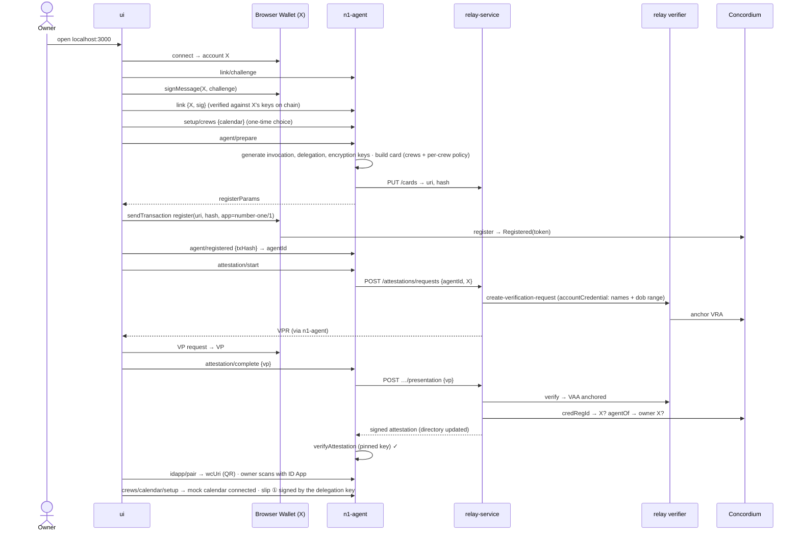
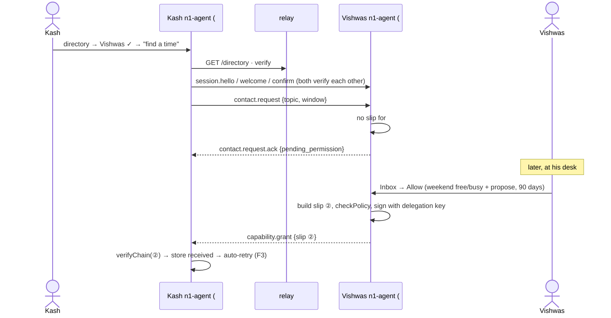
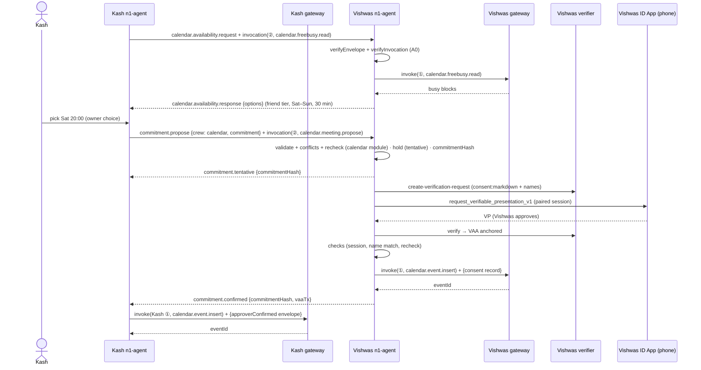

# End-to-end flows
Sequences across services. Each step references the spec that defines it.

## F1. Onboarding (once per user)

Specs: [ui.md](node/ui.md) §3 · [agent-card.md](shared/agent-card.md) · [attestation.md](shared/attestation.md) · [relay-service.md](relay/relay-service.md) §3.3

## F2. Connect + reactive grant (once per peer)

Specs: [messages.md](shared/messages.md) · [capabilities.md](shared/capabilities.md) §8 · [n1-agent.md](node/n1-agent.md) §5.2

## F3. Task + commitment while the approver is away (calendar crew)

The negotiation messages (`calendar.availability.*`) and the hooks (validate, recheck, execute) come from the calendar crew; everything else is the core commitment protocol, the same for every crew.

Specs: [consent.md](shared/consent.md) · [crews/calendar.md](crews/calendar.md) · [calendar-gateway.md](node/calendar-gateway.md) §3 · [n1-agent.md](node/n1-agent.md) §5.3

## F4. Revoke a slip
1. Vishwas → Permissions → **Revoke** on Kash's slip ②.
2. `n1-agent` adds the slip ID to its revocation list. From now on, any invocation fails with `CAP_REVOKED` (NT10).
3. `n1-agent` sends `capability.revoke` to Kash's N1, which marks the slip revoked and stops using it.

## F5. Rotate the delegation key / revoke the N1
- **Rotate:**
  1. Settings → **Rotate keys** → `keys/rotate/prepare`: new card, uploaded to the relay.
  2. Wallet `setAgentURI(token, uri, hash)`, then `keys/rotate/done`.
  3. Every slip signed by the old key now fails with `CAP_SIG_INVALID`. Re-allow peers as needed.
- **Revoke the N1:** Settings → **Revoke my N1** → wallet `revoke(token)`. Peers get `AGENT_REVOKED` on their next check (NT2), and the relay removes the agent from the directory on its next refresh.

## F6. Audit anchoring
Settings → **Anchor audit now** → `n1-agent` sends `RegisterData("N1-audit:<agentId>:<seq>:<hash>")` from the node service account. The UI shows the transaction, and anyone can check the hash chain against it (S8).
