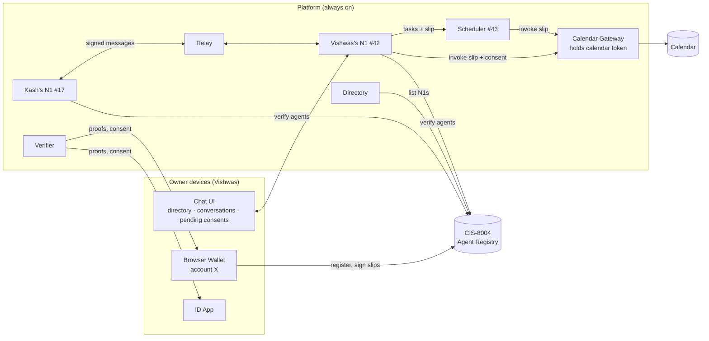
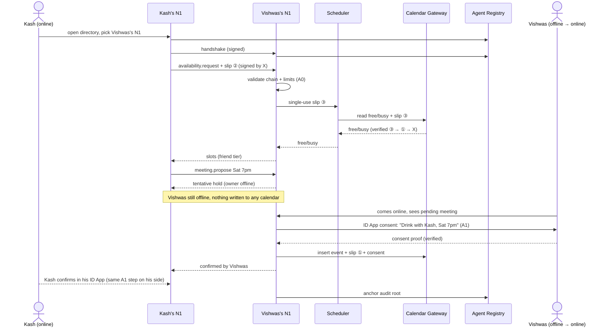

# Number One: Technical Solution
**Trust architecture for agent-to-agent communication on Concordium** · v0.3 · Nov 2026

> Vision, problem statement, business value and the user journey are in **[business-overview.md](business-overview.md)**.
> The POC scope will be defined next. Implementation details will go in `SPEC.md`.

---

## 1. Design decisions
| # | Decision |
|---|---|
| D1 | Each user has their own **ID-backed Concordium account X** in the **Browser Wallet**. It handles login, owns the agents and signs every grant (slip). |
| D2 | Every agent (N1 and each crew member) is **one CIS-8004 NFT** owned by X. Its keys are published in its Agent Card, whose hash is stored on chain. CIS-8 is not used. |
| D3 | The N1 is the only agent that talks across owners. It **forwards** tasks to its crew and never hands them off. |
| D4 | Authority is expressed as **capability chains** (the ZCAP pattern), every one rooted at account X |
| D5 | An **account-credential proof** (Browser Wallet), made once at onboarding, binds the person's verified name to their agents. **ID App consent** confirms every commitment, such as a meeting, and is extra evidence for every new grant. |
| D6 | One **platform verifier** (Concordium Credential Verification Service) issues and verifies all proofs |
| D7 | **Agents are always on, hosted by the platform,** so they can negotiate while their owners are offline. The platform holds agent keys (per-agent key store) and calendar tokens (inside the Gateway). Owner authority never leaves the owner: grants need X's signature, and commitments need the owner's ID App consent. **No private data goes on chain.** |
| D8 | All calendar access goes through a **Calendar Gateway**. It is the only holder of the calendar token and acts only on valid capability invocations (5.4). |
| D9 | **Agent directory:** users see every active N1 registered through the platform, read from CIS-8004. Each entry shows the owner's name, verified by the onboarding proof (TB5). Being listed grants nothing. |
| D10 | **First contact:** any verified N1 may send a `meeting.request` to another N1. Nothing is shared until the receiving owner issues a slip. |
| D11 | **Offline negotiation:** within existing slips, N1s negotiate without their owners. An agreed slot is held as **tentative** until **both owners confirm in the ID App** when they're back online. |

## 2. Architecture


## 3. Trust chain
```
Human ─KYC─► Identity Provider ─issues─► Concordium ID ─► Account X ─owns─► N1 #42 ─manages─► Scheduler #43
                                                              └─signs─► capability chains (who may do what)
```
- **Every link is verifiable**, except which human is behind account X. That is private by design, and the person's name is revealed only through a zero-knowledge proof (TB5).
- **N1 ↔ crew:** both are NFTs owned by X. Membership is a two-way on-chain metadata link (`crew` / `parent`). Authority comes through capabilities.

## 4. Trust boundaries
| TB | Boundary | Threat | Control | Concordium |
|---|---|---|---|---|
| TB1 | Owner ↔ own N1 | someone posing as the owner | Login signed by account X | ✅ |
| TB2 | N1 ↔ crew | fake crew member; crew obeying someone else | Same owner + two-way metadata; crew acts only through a single-use capability from its N1, enforced by the Calendar Gateway | ✅ / ⚠️ |
| TB3 | Agent ↔ calendar | an agent bypassing its slips, or over-broad access | **Calendar Gateway**: the only holder of the token, acts only on valid invocations; minimal OAuth scopes | ❌ |
| TB4 | N1 ↔ N1 identity | impostor or revoked agent | Registry lookup + card hash check + signed handshake | ✅ |
| TB5 | Agent ↔ person | real person's proof relayed to an impostor | Account-credential proof at onboarding, which must resolve to the agent's owner; the receipt is stored in registry metadata, so anyone can check it while the owner is offline | ✅ ¹ |
| TB6 | Permissions | stranger or out-of-scope request | Capability signed by X, checked on every request; without a slip, only `meeting.request` is accepted and nothing is shared | ✅ / ⚠️ |
| TB7 | Data minimization | oversharing | Sharing tiers (free/busy only for friends) | ❌ |
| TB8 | Message integrity | forgery, replay, prompt injection | Signed envelopes, nonces, strict message types | ❌ |
| TB9 | Transport | interception | End-to-end encryption; the relay sees nothing | ❌ |
| TB10 | Commitments | agent commits without the owner | The slot stays tentative until **each owner's ID App consent** for that exact slot; the Gateway inserts only with a verified consent | ✅ / ⚠️ ² |
| TB11 | Audit | "my agent never agreed" | Signed logs, anchored on chain | ✅ |
| TB12 | Revocation | stolen key still trusted | Registry revoke / key rotation; revoking a capability cascades | ✅ / ⚠️ |
| TB13 | Platform verifier | forged results | Results anchored on chain and re-checkable | ✅ / ⚠️ |
| TB14 | Hosting platform | the platform or its operator misusing hosted agents | Agent keys in a per-agent key store; agents can only use slips the owner signed; new grants need X's signature, and commitments need the owner's ID App consent. A compromised platform can't widen access or commit. | ❌ ours |

✅ covered by Concordium · ⚠️ partly · ❌ our own layer · ¹ pending a testnet check (G1) · ² ID App consent isn't tied to account X (G2)

## 5. Delegation model

### 5.1 Concepts
| Term | Meaning | In this use case |
|---|---|---|
| **Resource** | The thing being protected | Vishwas's calendar |
| **Root** | Full authority over the resource | Account X (Vishwas) |
| **Capability** | A signed permission slip: *who* may do *what*, on *which resource*, within *which limits*, *until when* | "Kash's N1 may read Vishwas's free/busy on weekends until Feb" |
| **Delegation** | Issuing a new, narrower slip from a slip you already hold | X → N1, X → Kash's N1, N1 → Scheduler |
| **Invocation** | Using a slip: a signed request carrying the slip and a fresh challenge | "When is Vishwas free?" + slip |
| **Caveat** | A limit inside the slip | weekends only, friend tier, single use |
| **Revocation** | Cancelling a slip, and with it every slip derived from it | Vishwas withdraws Kash's access |

### 5.2 Capability chain
```
root: Vishwas's calendar  (controller: account X)
 ├─ ① owner → N1 #42           read + insert events; inserting needs owner's ID App consent; can't delegate externally
 │   └─ ③ N1 → Scheduler #43   read free/busy, this request only, single use
 └─ ② owner → Kash's N1 #17    read free/busy (weekends) + propose meetings; until Feb; can't re-delegate
```
- **Only the owner** can grant access to other people's agents. A compromised N1 can't.
- **Permissions only shrink** down the chain. Unknown limits are rejected.
- **Revoking a parent** cancels everything below it.
- **No central service.** Vishwas's N1 checks invocations from other agents, and the Calendar Gateway (5.4) checks every access to the calendar.

### 5.3 Where it happens
| Step | Type | Who → whom | Slip used |
|---|---|---|---|
| Setup | delegation | X → N1 #42 | issues ① (signed by X) |
| Give permission | delegation | X → Kash's N1 #17 | issues ② (signed by X, plus ID App consent) |
| "When is Vishwas free?" | invocation | #17 → #42 | ② |
| Ask the Scheduler | delegation | #42 → #43 | issues ③ (signed by #42, narrower than ①) |
| Read free/busy | invocation | #43 → Calendar Gateway | ③ → ① → X |
| "Sat 7pm?" | invocation | #17 → #42 | ② |
| "Sat 7pm?" while Vishwas is offline | — | #42 holds the slot | tentative, no calendar write |
| Vishwas confirms (online) | invocation | #42 → Calendar Gateway | ① + Vishwas's ID App consent for that slot |

Kash has a mirror-image chain for **his** calendar and inserts the event there with his own slip ①.

### 5.4 Calendar Gateway
**Why it's needed**
- **Google Calendar doesn't understand capabilities.** Anyone holding the Google OAuth token has full access to whatever the token allows. Slips are only worth something if the token can't be used without one.
- **Agents are LLMs.** They can be confused or manipulated, for example by prompt injection. An agent holding the token directly could bypass every slip, limit and approval.
- **There must be one enforcement point.** If the N1, the Scheduler and future crew each held calendar access, every one of them would have to enforce the rules correctly, and one mistake would be enough.

**What it is**
- The **only component holding the Google OAuth token.** Agents never see it.
- It runs on the client (D7), as a separate, non-LLM process with a small fixed API: `freebusy.read`, `event.insert`.
- It acts **only on a valid invocation**:
  1. verify the chain back to account X
  2. check the caller is the slip's holder
  3. check the caveats (window, single use)
  4. check the required owner consent: an ID App consent proof, verified by the verifier, whose text contains this exact slot's hash
- It returns only what the slip allows: free/busy blocks, never event details unless the tier allows.
- It logs every decision to the audit log (TB11).

**Result:** even a fully compromised agent can't read more of the calendar, or write to it, than its slip permits.

## 6. Authorization levels
| Level | Used for | Mechanism |
|---|---|---|
| A0 | requests within a permission | capability check + sharing policy |
| A1 | commitments (confirm a meeting) | ID App consent for the exact slot, from each owner, given when they're back online |
| A2 | new permissions | capability signed by X + ID App consent |
| A3 | onboarding name proof / re-check on demand | account-credential proof (Browser Wallet) |

## 7. Technical flow


## 8. Concordium coverage
**Used:**
| Concordium component | Used for |
|---|---|
| Concordium ID + accounts | verified owner (TB1) |
| CIS-8004 Agent Registry | agent badges, ownership, crew links, revocation, directory, owner-proof receipt (TB2, TB4, TB5, TB12) |
| Verify & Access (Browser Wallet) | proving who owns an agent (TB5) |
| Human-in-the-Loop consent (ID App) | confirming meetings (A1); consent evidence for new permissions (A2) |
| Account signatures | login, capabilities (TB1, TB6) |
| `RegisterData` | audit and proof receipts (TB11, TB13) |

**Gaps (built by us or open):**
| # | Gap | Handling |
|---|---|---|
| G1 | Account-credential proof with a name reveal from the Browser Wallet is unconfirmed | Testnet check; fall back to a mixed proof |
| G2 | Consent screen only in the ID App, and ID App proofs aren't tied to an account | Grants: authority comes from X's signature. Commitments: consent is requested only through the owner's ID App session linked while logged in as X, with the slot hash and agent IDs in the text. Residual risk accepted for the POC; the hardening option is to also require X's signature. |
| G3 | No delegation standard | ZCAP v0.4 draft + our calendar profile |
| G4 | No DID method for agents; owner signs with a non-standard proof type | Agent IDs + card keys; custom proof type |
| G5 | No agent messaging layer | Our relay with E2E encryption |
| G6 | Agent keys live off-chain (Agent Card) | Card integrity via on-chain hash |
| G7 | Every registration, proof and anchor costs CCD; no fee sponsorship | Platform pays; anchors are batched |
| G8 | CIS-8004 is a draft; no reputation registry | Adapter layer; pinned contacts only |

