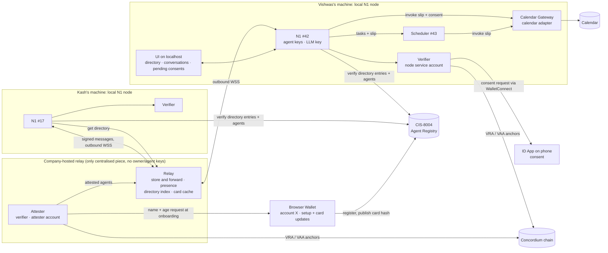
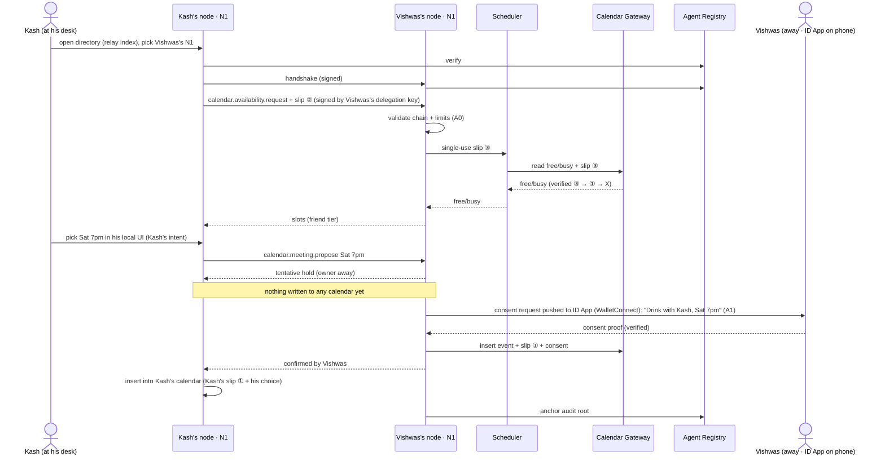

# Number One: Technical Solution
**Trust architecture for agent-to-agent communication on Concordium** · v0.6 · Nov 2026

> Vision, problem statement, business value and the user journey are in **[business-overview.md](business-overview.md)**.
> POC scope: [poc-scope.md](poc-scope.md). Implementation details: [spec/](spec/README.md).

---

## 1. Design decisions
**Principle: a decentralised platform.** Each user runs their own node, shipped as a Docker Compose bundle, with their own agent keys, calendar credentials and verifier. The **relay is the only centralised component** (company-hosted). It is trusted for one thing only, the **identity attestation** made at onboarding (D9), and it is untrusted for everything else.

| # | Decision |
|---|---|
| D1 | **No platform login.** Each owner runs their own N1 node (D7). A one-time setup in the **Browser Wallet** (ID-backed Concordium account X) links X to the node, deploys the N1 and produces the name + age proof. After that, the node authenticates to the relay with signatures from its agent key, verified against CIS-8004. Account X owns the agents and authorises the node's **delegation key** by publishing it in the Agent Card (D4). |
| D2 | Every agent (N1 and each crew member) is **one CIS-8004 NFT** owned by X. Its keys are published in its Agent Card, whose hash is set on chain by X's own transaction: an **invocation key** (messages, handshake, using slips), a **delegation key** (N1 only: signing slips), and an encryption key. CIS-8 is not used. |
| D3 | The N1 is the only agent that talks across owners. It **forwards** tasks to its crew and never hands them off. |
| D4 | Authority is expressed as **capability chains** (the ZCAP pattern), every one rooted at account X. X signs no slips itself. It authorises its N1's **delegation key** (Ed25519, held by `n1-agent`) and a **`delegationPolicy`** (the most any slip may grant, e.g. free/busy + propose, at most 90 days, no re-delegation) by publishing both in the Agent Card. The delegation key then signs slips ① and ② on the owner's click, with no wallet prompt. Verifiers resolve the root controller: X → X's N1 in CIS-8004 → card (hash checked) → delegation key + policy. Proofs use `eddsa-jcs-2022`. |
| D5 | An **account-credential ZK proof** from the Browser Wallet, made once at onboarding, binds the person's verified **name and age (18+)** to their agents. Onboarding needs only the Browser Wallet. **ID App consent** confirms every commitment, such as a meeting. |
| D6 | **Two verifiers, two jobs.** A Verify & Access proof (VP) is bound to one fresh request and **can't be re-verified later** (confirmed by Concordium DevRel), so whoever checks a proof must create the request and check the answer in real time. **(a) Onboarding (name + 18+):** the **relay's attester** (a Credential Verification Service run by the company) verifies the proof and issues a signed attestation (D9). **(b) Consent:** **each node runs its own verifier** (Docker) to request and verify **its own owner's** ID App consent. Each verifier signs its VRA/VAA anchors with a service account: the company's well-known **attester account** for (a), and a low-value **node service account** for (b), **never owner account X**. |
| D7 | **Each owner runs their own N1 node**, shipped as a **Docker Compose bundle**: the UI (localhost), the N1 server (agent keys, LLM API key), the Calendar Gateway (the owner's own calendar credentials) and the verifier (D6b). Everything that holds keys or data runs on the owner's machine. The **only centralised piece is the relay** (company-hosted): store-and-forward messaging, presence, the **attester** (D6a), the **directory index** (D9), and a cache of Agent Cards. It holds **no owner or agent keys and no calendar tokens**. Nodes connect to it outbound over WebSocket. **No private data goes on chain.** |
| D8 | All calendar access goes through a **Calendar Gateway**. It is the only holder of the calendar credentials and acts only on valid capability invocations (5.4). It uses pluggable calendar adapters (mock, Google, …). |
| D9 | **Directory: indexed by the relay, verified by each node.** CIS-8004 holds agents from many apps, and the chain can't be queried by tag, so discovery needs an index. **Membership:** at onboarding the relay's attester creates a fresh request (context: agent #42, account X, nonce). The owner answers from the Browser Wallet. The attester verifies the proof, checks it resolves to X and that X owns #42, anchors the VAA, and signs an **attestation** (agent, owner X, name, 18+, VAA reference, expiry). **Index:** the relay lists attested agents with their attestations, cards and presence. **Verify:** each node checks every entry before showing it: the agent is active in CIS-8004 and owned by X, the card hash matches, the attestation signature comes from the published attester key, and its VAA is on chain. The index can **hide** an agent but **can't add** one that isn't registered on chain. A false name would need a false attestation, which is anchored and auditable (TB14). Being listed grants nothing. |
| D10 | **First contact, then a reactive grant:** any verified N1 may send a `contact.request` to another N1. It lands in the receiving owner's **inbox**, and nothing is shared. When the owner is back at their desk, they **allow** the requester's agent from the inbox, choosing the scope (e.g. weekend free/busy + propose, until Feb). Their node's delegation key signs slip ② within the card's `delegationPolicy` (D4), with no wallet prompt. Slip ② is sent to the requester's N1, which retries automatically. Granting directly from the directory is a shortcut. Grants are per peer and need the owner present. Owner-away negotiation (D11) works only with peers already allowed. |
| D11 | **Owner away:** both nodes keep running while their owners are away from their desks. Within existing slips, N1s negotiate on their own. An agreed slot is held as **tentative** until the **approver** (the owner receiving the request) **confirms in the ID App on their phone**. The request is pushed through the WalletConnect session paired at setup. The requester's slot choice in their own local UI is their intent. |
| D12 | **Crews are plug-in modules.** An N1's capabilities (Calendar first; dietary, notes… later) are **crew modules**: a module in the N1 (actions, caveats, message types, intents, consent text) plus its own **gateway** (the only holder of that resource's data, same `/v1/invoke` contract), plus a **card entry**. The Agent Card lists installed `crews` and a `delegationPolicy` per crew. Resources are typed (`<crew>:…:<X>`), and actions and messages are namespaced (`calendar.freebusy.read`). Each owner chooses crews once at setup, inside the `register` transaction. Adding or removing a crew later is one card update (`setAgentURI`) signed by X, and **removing a crew revokes every slip for it** (peers' slips no longer verify). The **commitment flow** (propose → tentative hold → approver consent in the ID App → execute at the gateway → confirm) is part of the core and shared by every crew; a crew only supplies its negotiation messages and commitment hooks (validate, re-check, consent text, execute). The core and `trust-lib` never change for a new crew. On-chain crew *agents* (own NFT, slip ③, TB2) plug into the same module later. |

## 2. Architecture


## 3. Trust chain
```
Human ─KYC─► Identity Provider ─issues─► Concordium ID ─► Account X ─owns─► N1 #42 ─manages─► Scheduler #43
                                                              └─signs─► capability chains (who may do what)
```
- **Every link is verifiable**, except which human is behind account X. That is private by design, and the person's name is revealed only through a zero-knowledge proof (TB5).
- **N1 ↔ crew:** both are NFTs owned by X. Membership is a two-way on-chain metadata link (`crew` / `parent`). Authority comes through capabilities.

## 4. Trust boundaries
| TB | Boundary | Threat | Control | Concordium |
|---|---|---|---|---|
| TB1 | Owner ↔ own node | someone posing as the owner | The local UI runs on the owner's machine (access = machine access); the node is linked to X by a one-time wallet signature. Grants are limited by the `delegationPolicy` X published, and confirmations always need the ID App. Changing keys or policy needs the wallet. UI access alone can grant only within the policy. | ⚠️ |
| TB2 | N1 ↔ crew | fake crew member; crew obeying someone else | Same owner + two-way metadata; crew acts only through a single-use capability from its N1, enforced by the Calendar Gateway | ✅ / ⚠️ |
| TB3 | Agent ↔ calendar | an agent bypassing its slips, or over-broad access | **Calendar Gateway**: the only holder of the token, acts only on valid invocations; minimal OAuth scopes | ❌ |
| TB4 | N1 ↔ N1 identity | impostor or revoked agent | Registry lookup + card hash check + signed handshake | ✅ |
| TB5 | Agent ↔ person | real person's proof relayed to an impostor; a stale or replayed proof | A fresh account-credential proof at onboarding (name + 18+), requested and verified by the relay's attester. It must resolve to X, the agent's owner, and its context names the agent. The result is a signed attestation with an anchored VAA and an expiry (re-attest after it). Peers check the attestation and its VAA, plus live ownership in CIS-8004, even while the owner is away. | ✅ ¹ |
| TB6 | Permissions | stranger or out-of-scope request; a compromised node over-granting | Slip signed by the delegation key that X published in the Agent Card, within its `delegationPolicy`, checked on every request. Without a slip, only `contact.request` is accepted and nothing is shared. A compromised node can grant at most what the policy allows (never `calendar.event.insert`). | ✅ / ⚠️ |
| TB7 | Data minimization | oversharing | Sharing tiers (free/busy only for friends) | ❌ |
| TB8 | Message integrity | forgery, replay, prompt injection | Signed envelopes, nonces, strict message types | ❌ |
| TB9 | Transport | interception by the shared relay | End-to-end encryption to the recipient's card key; the relay sees nothing. This matters more now that the relay is shared and third-party hosted. | ❌ |
| TB10 | Commitments | agent commits without the owner | The slot stays tentative until the **approver's ID App consent** for that exact slot. The approver's Gateway inserts only with that consent; the requester's Gateway inserts on the requester's own choice in their local UI plus the approver's confirmation. | ✅ / ⚠️ ² |
| TB11 | Audit | "my agent never agreed" | Signed logs, anchored on chain | ✅ |
| TB12 | Revocation | stolen key still trusted | Registry revoke / key rotation; revoking a capability cascades. **Rotating the delegation key** (new card + `setAgentURI` signed by X) invalidates every slip it signed. | ✅ / ⚠️ |
| TB13 | Verifiers (attester + per node) | the attester vouching for the wrong person; a node's verifier lying about its own owner's consent | Attester: requests are bound to the agent and X, every attestation's VAA is anchored from the well-known attester account (auditable), and peers re-check ownership live. Node verifier: it only ever speaks for its own owner, and peers rely on the approver's signed confirmation plus the anchored VAA. | ✅ |
| TB14 | Relay (the only centralised component) | false attestations; hidden directory entries; dropped or delayed messages; false presence; tampered cached cards; reading message contents | **Trusted only for attestations (POC).** Everything else is verified: attestations against the attester key and VAA, entries against CIS-8004, cards against on-chain hashes, envelopes by agent-key signatures (E2E-encrypted in production, TB9). It holds no owner or agent keys. Worst case: a false attestation (auditable) or censorship and unavailability, never impersonation in messages, slips or consent. Production: several attesters or indexers. | ❌ ours |

✅ covered by Concordium · ⚠️ partly · ❌ our own layer · ¹ exact Browser Wallet call confirmed in the M0 spike (G1) · ² ID App consent isn't tied to account X (G2)

## 5. Delegation model

### 5.1 Concepts
| Term | Meaning | In this use case |
|---|---|---|
| **Resource** | The thing being protected | Vishwas's calendar |
| **Root** | Full authority over the resource | Account X (Vishwas) |
| **Capability** | A signed permission slip: *who* may do *what*, on *which resource*, within *which limits*, *until when* | "Kash's N1 may read Vishwas's free/busy on weekends until Feb" |
| **Delegation** | Issuing a new, narrower slip from a slip you already hold | X → N1, X → Kash's N1, N1 → Scheduler |
| **Invocation** | Using a slip: a signed request carrying the slip and a fresh challenge | "When is Vishwas free?" + slip |
| **Caveat** | A limit inside the slip | weekends only, friend tier, single use |
| **Revocation** | Cancelling a slip, and with it every slip derived from it | Vishwas withdraws Kash's access |

### 5.2 Capability chain
```
root: Vishwas's calendar  (controller: account X → delegation key in #42's Agent Card, within delegationPolicy)
 ├─ ① owner → N1 #42           read + insert events; inserting needs owner confirmation*; can't delegate externally
 │   └─ ③ N1 → Scheduler #43   read free/busy, this request only, single use
 └─ ② owner → Kash's N1 #17    read free/busy (weekends) + propose meetings; until Feb; can't re-delegate
```
- \* **Owner confirmation:** as the approver, an ID App consent for the exact slot. As the requester, the owner's own slot choice in their local UI (TB1).
- **Only the owner's delegation key** can grant access to other people's agents, and only within the `delegationPolicy` X published. The LLM never holds it: grants come only from the owner's click, handled in plain code.
- **Permissions only shrink** down the chain. Unknown limits are rejected.
- **Revoking a parent** cancels everything below it.
- **No central service.** Vishwas's N1 checks invocations from other agents, and the Calendar Gateway (5.4) checks every access to the calendar.

### 5.3 Where it happens
| Step | Type | Who → whom | Slip used |
|---|---|---|---|
| Setup | delegation | X → N1 #42 | issues ① (signed by the delegation key) |
| Give permission | delegation | X → Kash's N1 #17 | issues ② (signed by the delegation key, on the owner's **Allow**) |
| "When is Vishwas free?" | invocation | #17 → #42 | ② |
| Ask the Scheduler | delegation | #42 → #43 | issues ③ (signed by #42, narrower than ①) |
| Read free/busy | invocation | #43 → Calendar Gateway | ③ → ① → X |
| "Sat 7pm?" | invocation | #17 → #42 | ② |
| "Sat 7pm?" while Vishwas is away | — | #42 holds the slot | tentative, no calendar write |
| Vishwas confirms (ID App on phone) | invocation | #42 → Calendar Gateway | ① + Vishwas's ID App consent for that slot |

Kash has a mirror-image chain for **his** calendar and inserts the event there with his own slip ①.

### 5.4 Calendar Gateway
**Why it's needed**
- **Calendars don't understand capabilities.** Whoever holds the calendar credentials (e.g. a Google OAuth token) has full access to whatever they allow. Slips are only worth something if the credentials can't be used without one.
- **Agents are LLMs.** They can be confused or manipulated, for example by prompt injection. An agent holding the credentials directly could bypass every slip, limit and approval.
- **There must be one enforcement point.** If the N1, the Scheduler and future crew each held calendar access, every one of them would have to enforce the rules correctly, and one mistake would be enough.

**What it is**
- The **only component holding the calendar credentials.** Agents never see them.
- **Pluggable adapters** behind one fixed API: a mock calendar store (POC), Google Calendar (stretch), others later.
- It runs on the client (D7), as a separate, non-LLM process with a small fixed API: `calendar.freebusy.read`, `calendar.event.insert`.
- It acts **only on a valid invocation**:
  1. verify the chain back to account X
  2. check the caller is the slip's holder
  3. check the caveats (window, single use)
  4. check the owner confirmation: as the approver, an ID App consent proof (verified, with this exact slot's hash in the text); as the requester, the owner's own choice of this slot in their local UI
- It returns only what the slip allows: free/busy blocks, never event details unless the tier allows.
- It logs every decision to the audit log (TB11).

**Result:** even a fully compromised agent can't read more of the calendar, or write to it, than its slip permits.

## 6. Authorization levels
| Level | Used for | Mechanism |
|---|---|---|
| A0 | requests within a permission | capability check + sharing policy |
| A1 | commitments (confirm a meeting) | **Approver:** ID App consent for the exact slot, from their phone. **Requester:** their own slot choice in their local UI. |
| A2 | new permissions | the owner's **Allow** in the local UI; slip signed by the delegation key within `delegationPolicy` |
| A3 | onboarding name + age proof / re-check on demand | account-credential proof (Browser Wallet) |

## 7. Technical flow


## 8. Concordium coverage
**Used:**
| Concordium component | Used for |
|---|---|
| Concordium ID + accounts | verified owner (TB1) |
| CIS-8004 Agent Registry | agent badges, ownership, crew links, revocation, directory checks (TB2, TB4, TB5, TB12) |
| Verify & Access, via the Credential Verification Service | relay's attester: owner name + age proof from the Browser Wallet (TB5); each node: its owner's consent (TB10, TB13) |
| Human-in-the-Loop consent (ID App) | confirming meetings (A1); consent evidence for new permissions (A2) |
| Account signatures | wallet link, agent registration, publishing card keys + `delegationPolicy` (TB1, TB6) |
| `RegisterData` | audit and proof receipts (TB11, TB13) |

**Gaps (built by us or open):**
| # | Gap | Handling |
|---|---|---|
| G1 | Account-credential proof with a name reveal + age range from the Browser Wallet | **Largely resolved:** the team confirmed the Browser Wallet supports the Verify & Access flow. The M0 spike confirms the exact call and statements. |
| G2 | Consent screen only in the ID App, and its proofs use the identity credential, which is unlinkable to accounts. A consent proves **a verified human approved on the owner's paired device**, not account X. Today the only setup is Browser Wallet (X) + ID App (consent). | Grants: authority comes from X's signature. Commitments, by strength: **(1)** consent counts only through the WalletConnect session the owner paired with their own node at setup (after linking X), with the slot hash and agent IDs in the text. **(2)** If supported, the consent request also reveals `firstName` and `lastName`, which must match the owner's attestation (M0 spike). **(3)** Future: if the ID App can prove with the account credential of accounts created through the ID App SDK, a third-party wallet + ID App setup binds consent to X and closes G1 and G2 together. Residual risk accepted for the POC. |
| G3 | No delegation standard | ZCAP v0.4 draft + our calendar profile |
| G4 | No DID method for agents | Agent IDs + card keys (invocation, delegation, encryption), resolved via CIS-8004; standard `eddsa-jcs-2022` proofs |
| G5 | No agent messaging layer | Our relay with E2E encryption |
| G6 | Agent keys live off-chain (Agent Card) | Card integrity via on-chain hash |
| G7 | Every registration, proof and anchor costs CCD; no fee sponsorship | The attester account and each node service account are funded; audit anchors batched |
| G8 | CIS-8004 is a draft; no reputation registry | Adapter layer; pinned contacts only |
| G9 | A VP can't be re-verified later (it's bound to one fresh request; confirmed by Concordium DevRel), so a proof can't be published once for peers to check | A trusted attester (the relay) checks the fresh proof and issues a signed attestation anchored by a VAA (D9) |
| G10 | No way to list CIS-8004 agents by app or tag | The relay's directory index (D9); each node verifies its entries against the chain |

